# Material Choco

A desktop app and a remote management hub for the Chocolatey CLI. Manage packages on one Windows PC, or on every PC you look after, from a desktop app, a browser or a phone. The Chocolatey CLI built from this repository ships inside the app, so there is nothing else to install.

- **Site, with the download button and the guides:** <https://ding-ding-projects.github.io/choco/>
- **Demo in the browser:** <https://ding-ding-projects.github.io/choco/demo/>. The real interface against simulated machines. Nothing is installed and nothing leaves the browser.
- **Installer:** `Setup.exe` from the newest release whose tag starts with `material-choco-v`, on the [releases page](https://github.com/Ding-Ding-Projects/choco/releases). 64-bit Windows. **Not code signed**, so Windows may show an unknown publisher warning.
- **Hub:** `docker run -d -p 8080:8080 -v material-choco-data:/data ghcr.io/ding-ding-projects/material-choco-hub:latest`, then open `http://<host>:8080` and create the administrator.

> **Early build, said plainly.** The release was installed on Windows 11 on 2026-11-16 and used with the real Chocolatey CLI inside it: install, upgrade, pin, sources, features, uninstall and an automatic update all worked. The automated checks use a test stand-in for `choco.exe` and pass on Linux and Windows. The installer is not code signed. See [Honest status](#honest-status).

This repository is a **fork of the [Chocolatey CLI](https://github.com/chocolatey/choco)**. The CLI source is unchanged; the app lives in [`material-choco/`](material-choco/README.md). See [About this fork](#about-this-fork).

Contents: [Screens](#screens) · [What it does](#what-it-does) · [Hub quick start](#hub-quick-start) · [Honest status](#honest-status) · [Where to read more](#where-to-read-more) · [About this fork](#about-this-fork)

## Screens

Every picture here is a capture of the running hub and agents, taken by the project's end to end run in headless Chrome. They are not drawings. In that run a small test stand-in played the part of `choco.exe`, because the capture machine runs Linux, so package names and versions in the pictures come from the stand-in. The full set is in [`material-choco/docs/screenshots`](material-choco/docs/screenshots) and on the [site](https://ding-ding-projects.github.io/choco/#screens).

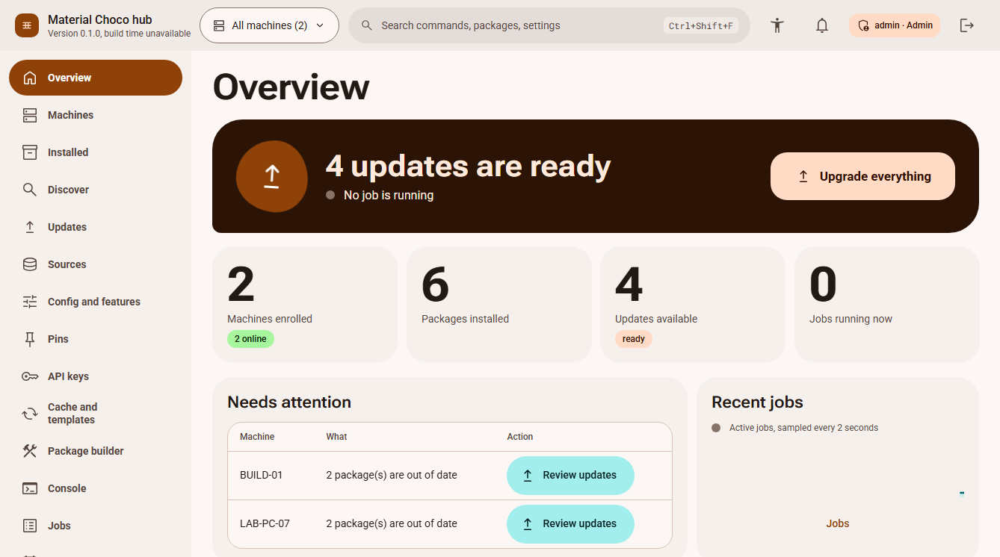

<details><summary><b>Daily work: packages, console, jobs</b> (4 captures)</summary>

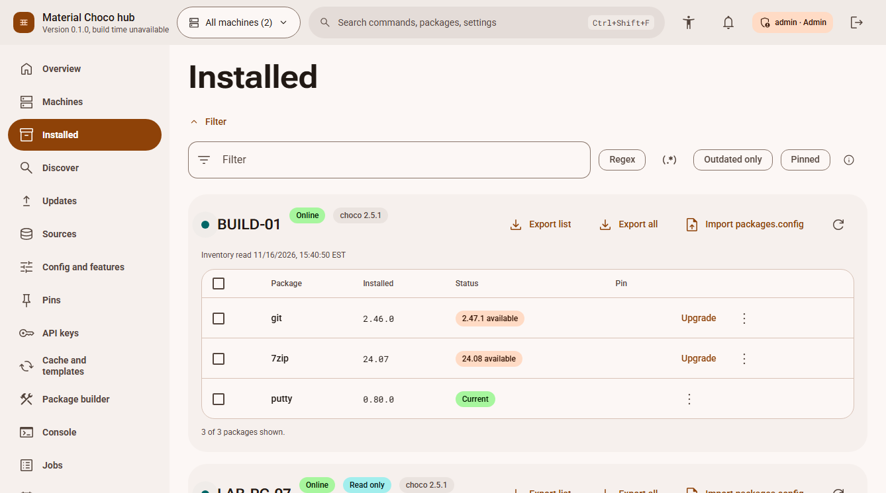

*Installed packages per machine, with bulk selection and export.*

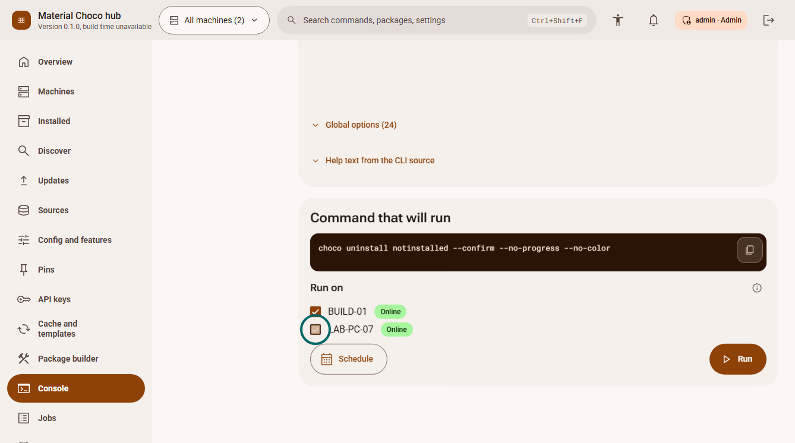

*Console: every command and option, with the exact command shown before it runs.*

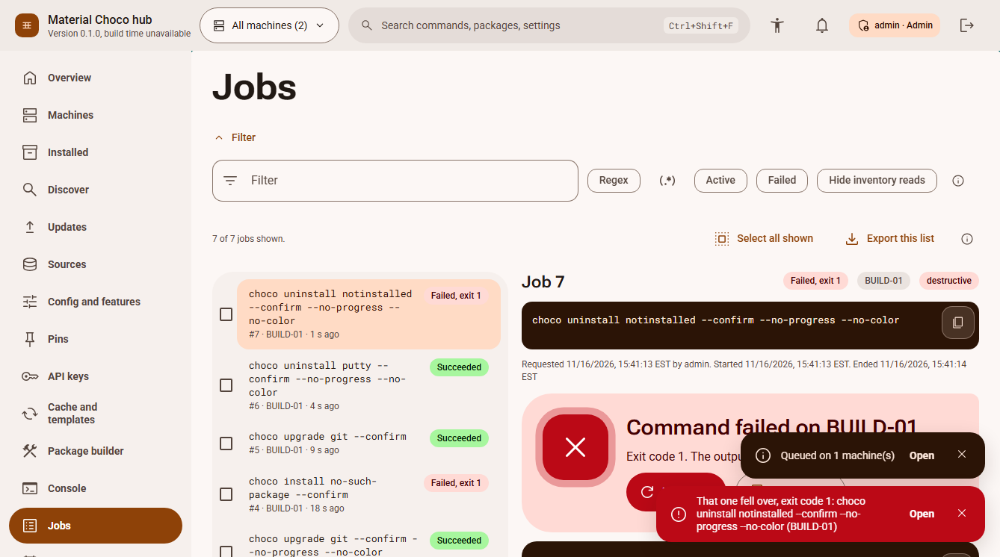

*A failed job with its exit code, its output and the recovery actions.*

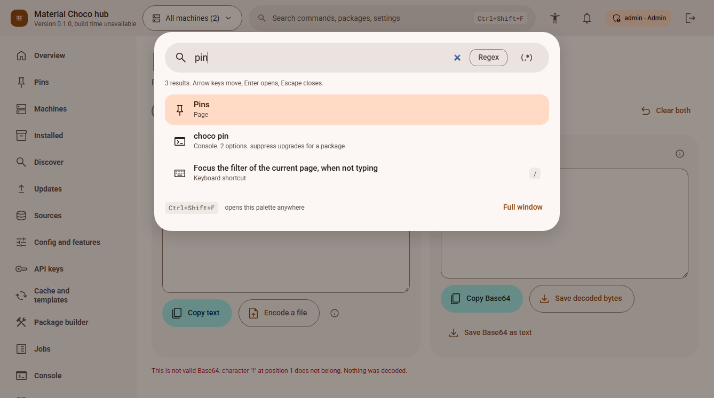

*Command palette on Ctrl+Shift+F.*

</details>

<details><summary><b>Safety and feedback</b> (3 captures)</summary>

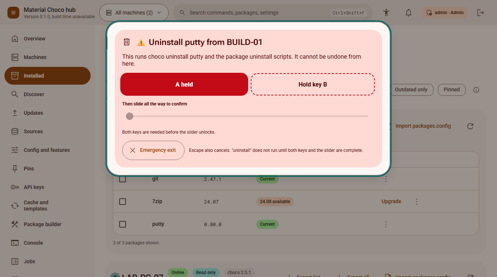

*Destructive actions need two keys and then a slider.*


*An upgrade that succeeded takes over the screen.*

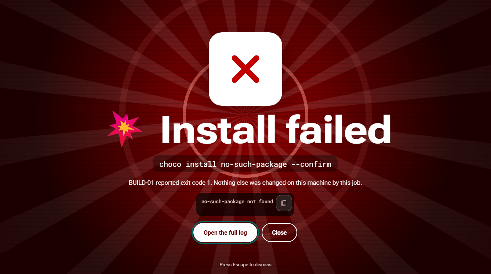

*An install that failed takes over the screen and stays until dismissed. The install was made to fail on purpose.*

</details>

<details><summary><b>Hub: users, passkeys, policy</b> (3 captures)</summary>

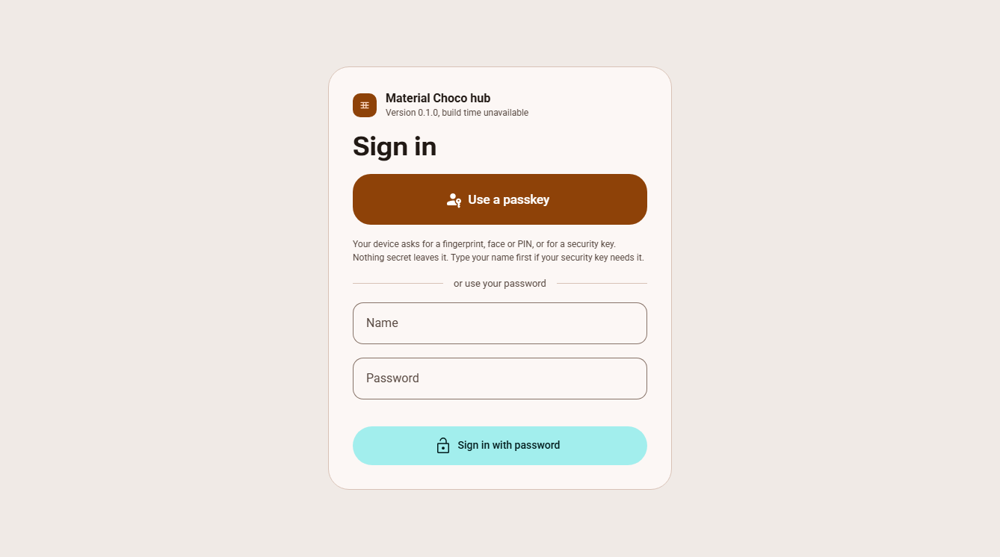

*Sign in with a passkey or a password. The passkey in the test run came from the browser's virtual passkey device.*

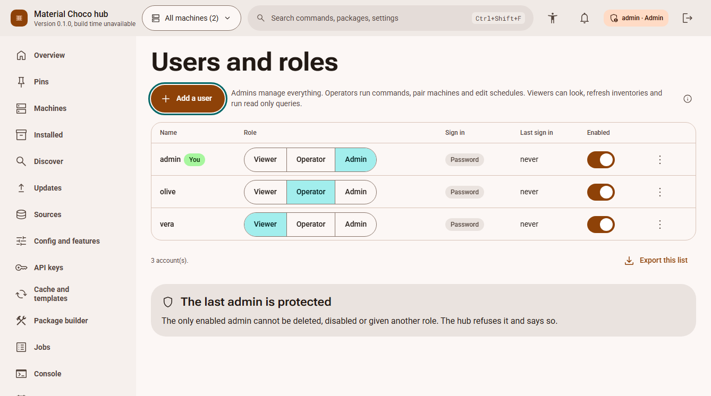

*Users with admin, operator and viewer roles.*

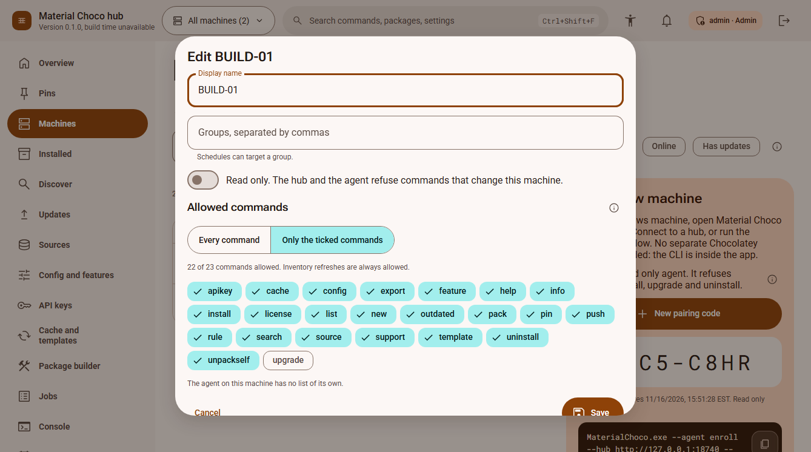

*Per-machine policy: read only, and a list of allowed commands.*

</details>

<details><summary><b>Look, language and phone</b> (2 captures)</summary>

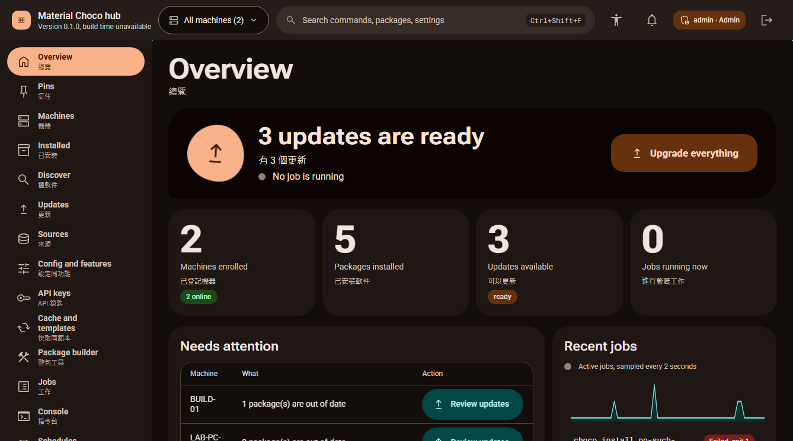

*Dark theme, bilingual mode.*

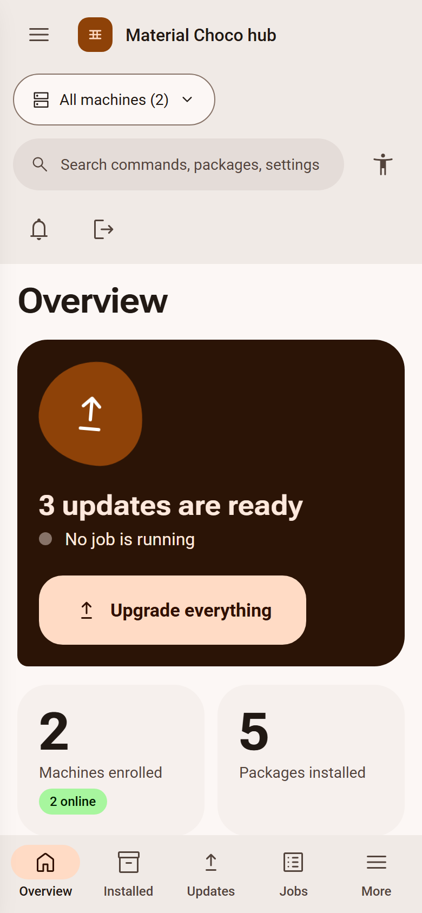

*The hub at phone width.*

</details>

## What it does

- **Every Chocolatey command and option.** The list is generated from the C# source of the CLI in this repository: 23 commands, 190 command options, 24 global options, 11 config settings and 30 features at the time of writing. A test fails when the list no longer matches the source.
- **Nothing to install first.** The installer carries its own runtime and a `choco.exe` built from this repository.
- **A fleet, not just a PC.** Pair machines to a hub with a one time code. Run a command on one, some or all. Jobs for an offline machine wait up to 7 days.
- **Hard to break by accident.** Destructive actions need two keys and a slider. A machine can be read only, or limited to a list of allowed commands.
- **You see what will run.** Every form shows the exact command, with a dry run. Source passwords and API keys are masked in records.
- **Loud when it matters.** Every install or upgrade that finishes takes over the screen with the result.

<details><summary>Pages of the app</summary>

Overview, Machines, Installed, Discover, Updates, Sources, Config and features, Pins, API keys, Cache and templates, Package builder, Console, Base64 tools, Jobs, Schedules, History, Help, Settings, and for hub admins Users and roles and Status webhooks.

</details>

<details><summary>Hub features</summary>

- Sign in with a password or a passkey. There are no authenticator codes; the maintainer removed them on 2026-11-16.
- Users with three roles: admin, operator, viewer. The hub checks the role on every request.
- One time pairing codes, with a QR code. Read only agents. Per-machine command allow lists, enforced by the hub and, when set on the machine, by the agent itself.
- Job queue with live output, cancel, exit codes and exported logs. Daily or weekly schedules.
- Append-only history with export.
- Status webhooks for failed jobs, offline machines and sign in lockouts. Job output is never sent.
- Secret option values and webhook addresses are encrypted in the hub's data file. Anyone who can read the whole data folder can also read the key, unless you move the key.

</details>

<details><summary>Interface</summary>

Material Design 3 Expressive, themed from one seed colour, light and dark. English, Hong Kong Cantonese and bilingual modes. Tabs that can be closed, pinned and reordered. A command palette, context menus with a filter, a pattern builder for regular expressions, bulk actions and exports on lists, timed settings, a custom logo, accessibility tools, and a reduced motion path for every animation.

</details>

## Hub quick start

```
docker run -d -p 8080:8080 -v material-choco-data:/data ghcr.io/ding-ding-projects/material-choco-hub:latest
```

1. Open `http://<host>:8080` and create the administrator. There is no default account.
2. On **Machines**, create a pairing code. It works once and expires after 10 minutes.
3. On the Windows machine, enter it in the app, or on a server without a desktop session:

```
MaterialChoco.exe --agent enroll --hub https://your-hub --code XXXX-XXXX
MaterialChoco.exe --agent run
```

**Treat hub access as administrator access.** The hub can install software with administrator rights on every paired machine. Serve it over HTTPS; agents refuse plain HTTP to a remote hub unless you opt in. Read the [security model](https://ding-ding-projects.github.io/choco/articles/security-model.html) first.

## Honest status

| | |
| --- | --- |
| **Checked** | On Windows 11 (2026-11-16): release 0.1.16 matched its SHA-256 sums, installed, and with its real CLI installed, upgraded, pinned and uninstalled a package and changed a source and a feature; 0.1.15 updated itself to 0.1.16; a job sent from the hub ran there; `build.bat` and `build-installer.bat` worked from a clean clone. Automated, on Linux and Windows: `npm test` 95 of 95, end to end run 121 of 121, demo 26 of 26, clipping check 36 of 36 sizes. The site is live and was measured at phone widths. |
| **Not proven** | A build on a Windows machine with nothing installed. Passkeys on a real device (they were checked with a software passkey device and Chrome's virtual one; over plain HTTP on a LAN address browsers do not offer them). Working offline. No screen reader pass and no accessibility audit. |
| **Not signed** | The installer is not code signed. |
| **Not built** | Signed agent updates, limiting a user to some machines, and much of the maintainer's wider feature catalogue. The exact count is in the feature inventory. |

## Where to read more

| | |
| --- | --- |
| [material-choco/README.md](material-choco/README.md) | The app in detail: structure, security, build, tests, size |
| [material-choco/HANDOFF.md](material-choco/HANDOFF.md) | Exactly what was checked, with results, and what was not |
| [material-choco/ROADMAP.md](material-choco/ROADMAP.md) | What is done and what is next |
| [material-choco/docs/FEATURE-INVENTORY.md](material-choco/docs/FEATURE-INVENTORY.md) | The state of every required feature, built or not |
| [material-choco/docs/features](material-choco/docs/features/README.md) | One document per shipped feature |
| [material-choco/docs/articles](material-choco/docs/articles/README.md) | How-to guides, also on the site |
| [material-choco/docs/api](material-choco/docs/api/README.md) | Hub HTTP API and Postman collection |
| [design/material-choco](design/material-choco/README.md) | The design files |

## About this fork

This repository is a fork of the **Chocolatey CLI**, the package manager for Windows, made by Chocolatey Software, Inc. and its contributors and licensed under Apache-2.0.

- Upstream project: <https://github.com/chocolatey/choco>
- Chocolatey documentation: <https://docs.chocolatey.org/en-us/>
- Community package repository: <https://community.chocolatey.org>

What this fork adds: the `material-choco/` and `design/` folders, two workflows under `.github/workflows` whose names start with `material-choco`, and a few files at the root (`AGENTS.md`, `CLOSEOUT_PROMPT.md`, this README). **No file of the Chocolatey CLI itself was changed.** The app runs the CLI as a separate program and reads its source only to generate the list of commands and options.

Material Choco is **not affiliated with or endorsed by Chocolatey Software, Inc.** "Chocolatey" is their trademark. The CLI that ships inside the app is built from this repository and not by Chocolatey Software, which is why the app passes `--allow-unofficial-build` to it. For the official, supported Chocolatey, use the upstream project.

Licence: Apache-2.0, the same as upstream, for the fork's additions too. See [LICENSE](LICENSE) and [NOTICE](NOTICE). Credits of the CLI are in [docs/legal/CREDITS.md](docs/legal/CREDITS.md).

<details><summary>Building and testing the Chocolatey CLI itself (kept from the upstream README)</summary>

Requirements to run the CLI: .NET Framework 4.8 or newer, PowerShell 2.0 or newer, Windows Server 2008 R2 or newer, or Windows 10 or newer. See the upstream [support lifecycle](https://docs.chocolatey.org/en-us/information/support-lifecycle).

`build.bat` and `build.sh` at the repository root belong to the CLI. They create a generated file named `SolutionVersion.cs` and must be run at least once before Visual Studio will build.

**Windows.** Minimum requirements: .NET Framework 4.8, the .NET Framework 4.8 Dev Pack, Visual Studio 2019 or its Build Tools, and the .NET SDK (to install .NET global tools). `setup.ps1` at the root can install these. Then run `build.bat`. The build assumes the Chocolatey CLI is installed on the build machine, because it is used to create the final package; skip that step with `.\build.bat --shouldRunChocolatey=false`.

**Other platforms.** Install Mono (6.6 or newer; `docker/Dockerfile.linux` names the recommended version) and the .NET 6.0 SDK or newer, and Git 2.22 or newer when building from Git. Make the scripts executable with `chmod +x *.sh`, then run `./build.sh`. The upstream README notes that a build on Mono may have rough edges.

**Installing a build on other platforms.** Copy the contents of `./code_drop/temp/_PublishedApps/choco` to an install directory (`/opt/chocolatey` is preferred on Linux), export `ChocolateyInstall` pointing at it, and copy `./docker/choco_wrapper` to a directory on the `PATH` under the name `choco`.

**Tests of the CLI.** Unit and integration tests use NUnit; end to end tests use Pester and can change the system, so upstream recommends its Vagrant file. All of this is described in [TESTING.md](TESTING.md).

**Contributing to the CLI.** See [CONTRIBUTING.md](CONTRIBUTING.md) and [COMMITTERS.md](COMMITTERS.md). Changes to the CLI belong upstream, not in this fork. The CLI's own changelog is [CHANGELOG.md](CHANGELOG.md).

The original upstream README, with its badges, community links and full instructions, is at <https://github.com/chocolatey/choco#readme>.

</details>

<details><summary>Notes for people and agents working in this repository</summary>

Read [AGENTS.md](AGENTS.md). In short: do not change the CLI source under `src/` for app work; after a CLI option changes, run `node material-choco/scripts/gen-schema.mjs`; run `npm test` and `npm run test:e2e` in `material-choco/` before pushing and record the real results in `material-choco/HANDOFF.md`; update the roadmap, the handoff and the feature inventory in the same change as the work they describe. [CLOSEOUT_PROMPT.md](CLOSEOUT_PROMPT.md) holds a ready-to-paste prompt for continuing the work.

</details>
