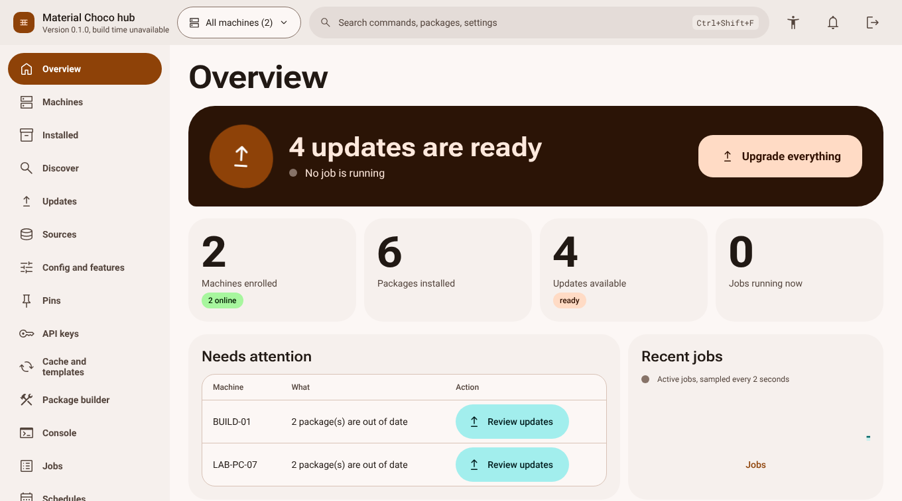

# Material Choco

A desktop app and a remote management hub for the Chocolatey CLI in this repository.

- **Desktop app (Windows):** manages Chocolatey on the PC it runs on. The Chocolatey CLI built from this repository ships inside the app. Nothing else has to be installed.
- **Hub (container):** a web app for managing many Windows machines from a browser, phone included. Each machine connects out to the hub as an agent.

**Install:** download `Setup.exe` from the [latest release](https://github.com/Ding-Ding-Projects/choco/releases) and run it. The installer is not code signed, so Windows may show an unknown publisher warning.

**Hub:** `docker compose up -d` in this folder, then open `http://<host>:8080` and create the administrator.

Status: version 0.1.0, first build. Read [HANDOFF.md](HANDOFF.md) for exactly what was checked and what was not.

Contents: [What it does](#what-it-does) · [How it fits together](#how-it-fits-together) · [Security](#security) · [Build](#build) · [Tests](#tests) · [Required-feature inventory](docs/FEATURE-INVENTORY.md) · [Roadmap](ROADMAP.md) · [Design files](../design/material-choco/README.md)



Screenshots in `docs/screenshots` are captured from the real running hub and agents by `test/e2e/run.mjs`. In that run a small test fixture stands in for `choco.exe`, because the capture machine is Linux; package names and versions in the pictures come from that fixture.

## What it does

<details><summary>Every Chocolatey command and option</summary>

`scripts/gen-schema.mjs` reads the C# command classes under `src/chocolatey` and writes `shared/choco-schema.json`: 23 commands, 190 command options, 24 global options, 11 config settings and 30 features at the time of writing. The Console page builds a form for each command from that file, and a test fails when the file no longer matches the source. So an option added to the CLI appears in the app after the generator runs.

Dedicated pages cover the daily work: installed packages with bulk upgrade, pin, uninstall and `packages.config` export and import; search and install with every install option; updates per machine; sources; config settings and features; pins; API keys; cache, templates, rules, licence and support; new, pack and push.
</details>

<details><summary>Remote management</summary>

- Pair a machine with a one time code that expires after 10 minutes.
- Run any command on one machine, several, or all of them. Jobs for an offline machine wait up to 7 days.
- Live output, cancel, exit codes, exported logs.
- Daily or weekly schedules on the hub, for all machines, a group, or a chosen set.
- A read only agent refuses every command that changes the machine. The agent enforces this itself.
- Append-only history with CSV, JSON and Markdown export.
</details>

<details><summary>Interface</summary>

Material Design 3 Expressive, themed from one seed colour, light and dark. English, Hong Kong Cantonese and bilingual modes. Command palette on Ctrl+Shift+F. Context menus with a filter field. A two key confirmation with a slider before destructive actions. Loading, empty, offline, success and error states each have their own design and motion, and every animation has a reduced motion path. Accessibility tools for text size, contrast, motion, target size and focus ring.
</details>

## How it fits together

<details><summary>Folders</summary>

| Folder | What |
| --- | --- |
| `core/` | CLI wrapper (`choco.js`), bundled CLI setup (`bundle.js`), job runner, agent |
| `hub/` | HTTP server, sign in, jobs, schedules, store, `Dockerfile` |
| `desktop/` | Desktop shell: frameless window, the hub in-process on 127.0.0.1, agent mode |
| `ui/` | The interface, shared by the desktop app and the hub. `ui/vendor` is generated |
| `shared/` | `choco-schema.json`, generated from the CLI source |
| `test/` | Unit, integration and end to end checks |
</details>

<details><summary>Headless agent</summary>

On a server without a desktop session:

```
MaterialChoco.exe --agent enroll --hub https://hub.example:8443 --code XXXX-XXXX
MaterialChoco.exe --agent run
```
</details>

<details><summary>Hub HTTP API</summary>

See [docs/api/README.md](docs/api/README.md) and the Postman collection [docs/api/material-choco.postman_collection.json](docs/api/material-choco.postman_collection.json).
</details>

## Security

<details open><summary>Read this before exposing a hub</summary>

- The hub can install software with administrator rights on every enrolled machine. Hub access is administrator access.
- Serve the hub over HTTPS (set `MATERIAL_CHOCO_TLS_CERT` and `MATERIAL_CHOCO_TLS_KEY`, or use a reverse proxy). Agents refuse plain HTTP to a remote hub unless started with `--allow-insecure`.
- Passwords are stored as salted scrypt hashes. Optional authenticator codes (TOTP). Failed sign ins lock out with growing delays. Sessions use an HttpOnly, SameSite=Strict cookie and cross-site requests are refused.
- Agents hold a random token; the hub stores only its hash. Removing a machine revokes it.
- Commands are argument lists checked against the CLI option list and run without a shell.
- Source passwords and API keys are masked in job logs and history. They do pass through the hub in memory and are stored in the job queue until the agent takes the job.
- Not yet built: passkeys, per-user roles, signed agent updates. One administrator account per hub.
</details>

## Build

<details><summary>Windows</summary>

`build.bat` in this folder builds the CLI from the repository root, installs npm packages, and starts the app. `build-installer.bat` produces the Squirrel.Windows installer in `dist\squirrel-windows`. Both accept `/s`, `--silent` or `SILENT=1`. The repository root already has the Chocolatey project's own `build.bat`, so these live here.

These two scripts were written on Linux and have **not been run on Windows yet**. The release workflow does the same steps on a hosted Windows runner and has produced a working build of the installer; the installed app itself has not been started on Windows yet.
</details>

<details><summary>Any platform, for development</summary>

```
npm ci
node scripts/gen-schema.mjs      # refresh the schema from the C# source
node scripts/build-vendor.mjs    # rebuild ui/vendor
npm run hub                      # hub on http://localhost:8080
npm start                        # desktop app
```
</details>

## Tests

<details><summary>What runs</summary>

- `npm test`: 22 unit and integration tests. They start a real hub and a real agent in-process.
- `npm run test:e2e`: drives the real UI in headless Chrome against a real hub and two agent processes, 31 checks, and refreshes the screenshots.
</details>

## Size

<details><summary>Line count and effort estimate</summary>

Hand-written lines, excluding `ui/vendor`, `shared/choco-schema.json`, `node_modules` and the design export: **2387** (`cat core/*.js hub/*.js desktop/*.js scripts/*.mjs test/*.js test/e2e/*.mjs test/fixtures/*.js ui/index.html ui/styles.css ui/js/*.js build*.bat | wc -l`).

Estimate for one experienced developer writing this by hand: at 60 to 120 finished, tested lines a day, 2387 / 120 to 2387 / 60 is about 19 to 39 working days. Many lines here are long, so the upper end is the more realistic one. This is an estimate, not a measurement.
</details>

## Licence

Apache-2.0, the same as the repository. Not affiliated with or endorsed by Chocolatey Software, Inc. "Chocolatey" is their trademark.
