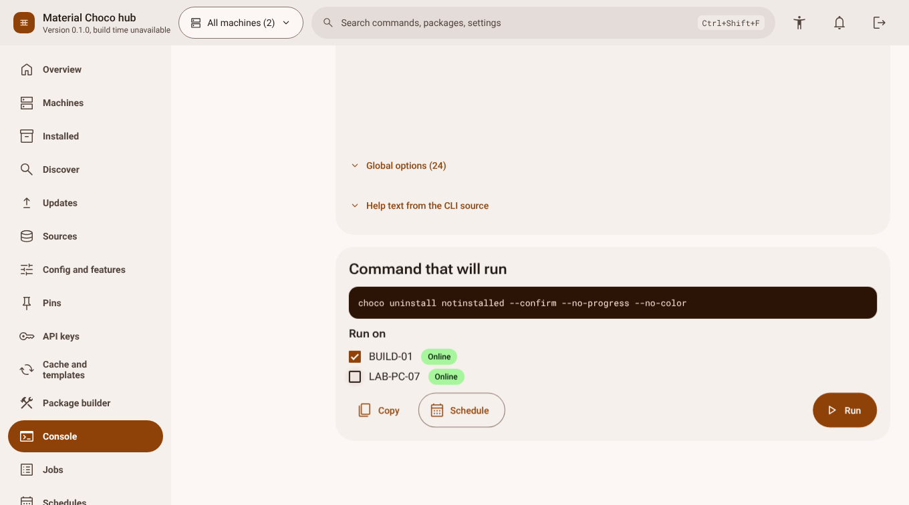

# Every command and option

Material Choco does not keep its own list of what Chocolatey can do. It reads the list from the CLI source in the same repository, so every command and every option has a control.

## Where the list comes from

`scripts/gen-schema.mjs` reads the C# command classes under `src/chocolatey` and writes `shared/choco-schema.json`. At the time of writing that file holds 23 commands, 190 command options, 24 global options, 11 config settings and 30 features. A test fails when the file no longer matches the source, so the list cannot drift silently. When the CLI gains an option, run the generator and the app gains a control.

## The Console

Open **Console**. The left column lists every command; deprecated ones are marked.

1. Pick a command. Commands with subcommands, such as `source` or `pin`, show them as a row of buttons.
2. Type positional arguments, for example package ids, separated by spaces. Put double quotes around an argument that contains spaces.
3. Set options. A switch is a toggle; an option that takes a value is a text field. Each one has an information button that shows the description from the CLI source and every accepted spelling of the option.
4. With more than six options, a filter field narrows the list.
5. Open **Global options** for the options every command accepts.
6. Watch **Command that will run**. It updates as you type and shows exactly what the agent will be asked to run.
7. Choose the machines under **Run on**, then **Run**. **Schedule** sends the command to the Schedules page to run on a timetable, and **Copy** copies the command text. For a dry run, turn on `--what-if` under **Global options**; the dialogs on the daily pages have a **Dry run with --what-if** button that does this for you.

Commands that remove things (`uninstall`, `unpackself`, and the `remove` and `unset` subcommands) ask for the [two key confirmation](confirming-destructive-actions.md) first.

## The same forms elsewhere

The daily pages open the same generated form with the fields already filled in:

| Page | Uses |
| --- | --- |
| Installed | `upgrade`, `uninstall`, `pin`, `info`, and `install` with a `packages.config` |
| Discover | `search`, then `install` with every install option |
| Updates | `outdated` through the inventory, then `upgrade` |
| Sources | `source` add, remove, enable, disable |
| Config and features | `config` set and unset, `feature` enable and disable |
| Pins | `pin` add and remove |
| API keys | `apikey` list, add, remove |
| Cache and templates | `cache`, `template`, `rule`, `license`, `support` |
| Package builder | `new`, `pack`, `push`, `export` |

## Options added for you

- `--confirm`, `--no-progress` and `--no-color` are added to commands you start, because nobody is sitting at the remote console to answer a prompt. They are shown in the preview.
- `--allow-unofficial-build` is added by the agent, because the bundled CLI is built from this repository and not by Chocolatey Software. It is added on the machine and is not part of the preview.
- Inventory reads add `--limit-output` so that the result can be parsed.

## What is refused

The hub and the agent both check a request before anything runs: unknown commands or options, arguments that start with `-`, values with line breaks. See the [security model](security-model.md).

## What was checked

- Tests `schema matches the CLI source in this repository` and `schema covers every command file` in `test/core.test.js`.
- Tests `buildArgs builds validated arguments without a shell` and `buildArgs rejects unknown commands, options, subcommands and option injection`.
- End to end checks `console preview shows the exact command`, `config page lists every CLI feature` and `failed job shows exit code and output`.

## Known limits

- Every check so far ran against a test stand-in for `choco.exe`. No command has been run through the app on Windows yet.
- The parsers for `--limit-output` rows of `apikey list`, `template list` and `rule list` were written from the source, not from real output. Those pages show raw output where no parser applies.
- The form is generic: it does not know which combinations of options make sense together. The CLI still validates and reports errors, which you see in the job output.
- Options that exist only in the licensed edition of Chocolatey appear if they are in this repository's source, and do nothing without that edition.

## Related

- [Jobs, schedules and history](jobs-schedules-and-history.md): what happens after Run
- [Confirming destructive actions](confirming-destructive-actions.md): two keys and a slider
- [Command schema](../features/command-schema.md): the generator in detail
- [Console](../features/console.md): the feature page
