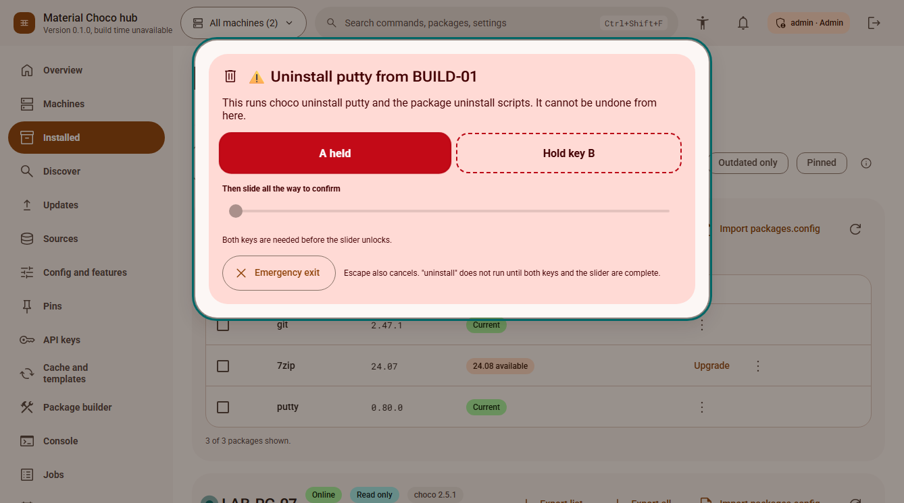

# Confirming destructive actions

Before the app removes something, it asks for two keys and a slider. One stray click, or one stray key press, cannot uninstall a package from a fleet.

## What asks for it

- Uninstalling a package, from a row menu, the bulk bar or the Console.
- Removing a source, unsetting a config value, removing an API key, removing a pin through the Console.
- Removing the whole HTTP cache.
- Removing a machine from the hub.
- Resetting every setting on the device.
- `unpackself` in the Console.

Installs and upgrades do not ask, because they can be reversed by uninstalling or by installing another version.

## How it works

1. A dialog names exactly what will happen, for example the command and the number of machines.
2. Turn on **key A** and **key B**. Each is a separate button. The slider stays locked until both are held.
3. Drag the slider all the way to the end. Letting go early returns it to the start.
4. Only then does the action run.

**Emergency exit** and `Escape` cancel at any point. Turning either key off again locks and resets the slider. A line of text in the dialog always says which state it is in, and it is announced to screen readers.

## With the keyboard

`Tab` moves between the two keys, the slider and the exit button. `Space` or `Enter` toggles a key. The slider follows the arrow keys, `Home` and `End`.

## What it is not

This is protection against accidents. It is not an approval by a second person: one person can turn both keys. It is also separate from the read only setting of an agent, which refuses changes no matter who confirms. See [Pairing and remote agents](pairing-and-remote-agents.md).

## What was checked

End to end checks in `test/e2e/run.mjs`: `slider is locked before both keys`, `one key and a full slider does not confirm`, and `uninstall runs only after both keys and the slider`.

## Known limits

- Keyboard and screen reader use of the dialog was written to the rules above and has not been audited with assistive technology.
- The same confirmation is used for every destructive action. There is no setting to skip it.

## Related

- [Install result takeovers](install-result-takeovers.md): the other half of careful feedback
- [Security model](security-model.md): protection against attackers, as opposed to accidents
- [Two key confirmation](../features/two-key-confirmation.md): the feature page
