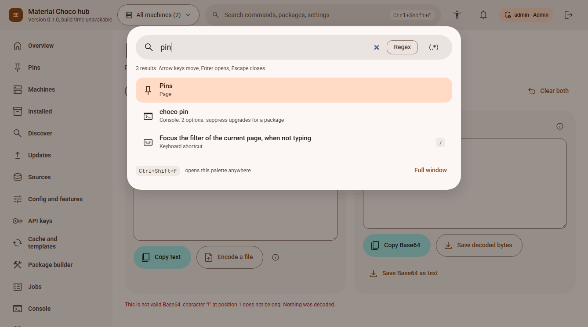
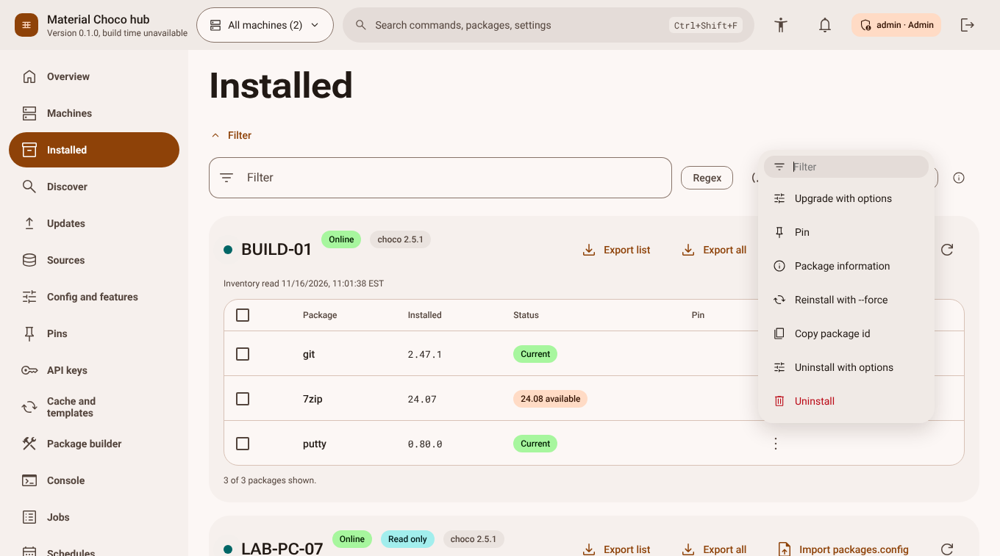
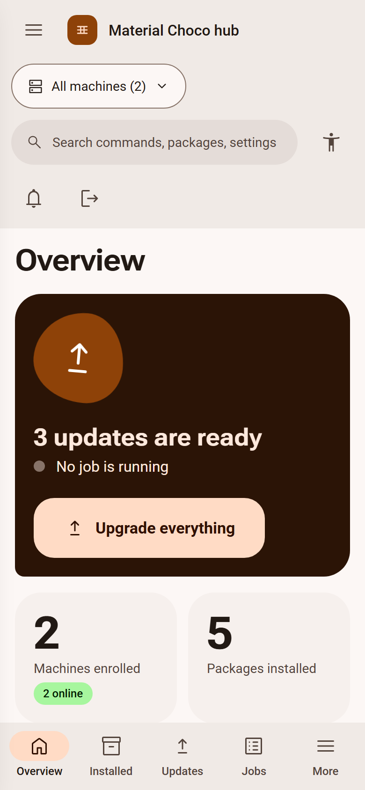

# Finding your way around

A page for each kind of work, a command palette that reaches all of them, menus on rows, and filters on lists. This guide is a short tour of how the interface is organised.

## Pages as tabs

Every page is a tab in the strip on the left, and every tab is open by default. They include Overview, Machines, Installed, Discover, Updates, Sources, Config and features, Pins, API keys, Cache and templates, Package builder, Console, Jobs, Schedules, History, Help and Settings.

- Close a tab you do not use with its close button. **New tab** at the bottom of the strip reopens it.
- Right click a tab, or press `Shift+F10` on it, to pin it to the top, close the others, or open every tab again.
- The up and down arrow keys move between tabs. Drag a tab onto another to reorder, or press `Alt+ArrowUp` and `Alt+ArrowDown` on a focused tab.
- Your choices are remembered in this browser.

## The machine selector

The button at the top that reads **All machines** decides which machines the pages show and act on. Pick one, several or all.

## The command palette

Press `Ctrl+Shift+F` anywhere, or use the search field in the top bar. The palette finds:

- every page,
- commands such as **Upgrade everything** and **Refresh inventory**,
- every Chocolatey command, which opens in the Console,
- every setting, with on or off settings shown as a live switch you can flip without leaving the palette,
- keyboard shortcuts and paired machines.

Arrow keys move, `Enter` opens, `Escape` closes. Choosing a setting opens Settings on the right tab, scrolls to the setting and highlights it. A **Regex** switch turns the query into a regular expression, with a pattern builder beside it, and a button toggles between a card and a full-window palette.

## Menus everywhere

Package rows, machine rows, source rows and tabs have a menu of their own actions: use the three dots, right click, or `Shift+F10`. Anything else opens a general menu with copy, search, refresh, accessibility tools and settings. Every menu opens with a filter field already focused, so you can type a few letters and press `Enter`. Where an action has a keyboard shortcut, the menu shows it.

## Filters

Lists have a foldable filter bar: a text field, a **Regex** switch and chips such as **Outdated only** or **Online**. A folded bar shows how many filters are active, and whether it is folded is remembered per page. A pattern that is not a valid regular expression shows its error and matches nothing; it never breaks the page. If you would rather not write patterns, the button beside the switch opens a builder: fill in starts with, contains, ends with, any of these, or does not contain, and it writes the pattern and previews the matches.

Lists with tick boxes act on several rows at once, and most lists export as CSV, JSON or Markdown.

## States that tell the truth

No sample data ships. Before a machine is paired, pages say that nothing is enrolled and offer the way to pair one. While data loads you see placeholders, an offline machine is labelled with the time of its last inventory, and a page that hits an error shows the error and keeps the rest of the app working.

## On a phone

At phone width the tab strip becomes a bottom bar with Overview, Installed, Updates, Jobs and **More**, which opens the full list. Tables scroll inside their own area.

## Help that works offline

The **Help** page holds short articles, the list of keyboard shortcuts and the help text of every Chocolatey command taken from the CLI source. It needs no network.

## What was checked

End to end checks: `Ctrl+Shift+F opens the palette and filters`, `row menu opens with a filter field focused`, `context menu opens on an element without its own`, `a tab can be moved by drag and drop`, `a built pattern filters the list it was opened from`, `empty state is truthful before any machine`, and `phone layout has no horizontal overflow`.

## Known limits

- Tabs cannot be grouped or docked to another edge.
- Only rows, tabs and machines have actions of their own in their menus.
- Only one phone width was checked for overflow.

## Related

- [Every command and option](commands-and-options.md): the Console in detail
- [Languages and accessibility](languages-and-accessibility.md): shortcuts and comfort settings
- [Command palette](../features/command-palette.md): the feature page
- [Tabs](../features/tabs.md): the feature page
- [Pattern builder](../features/pattern-builder.md): the feature page
