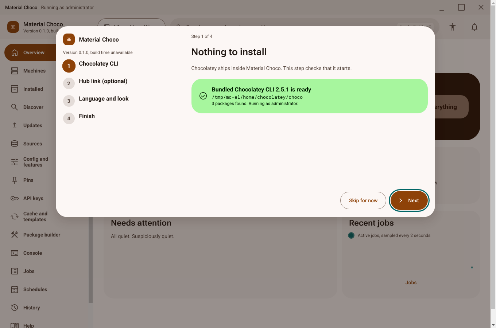

# Getting started on one PC

Install the desktop app and manage Chocolatey packages on the Windows PC it runs on. No hub, no account and no separate Chocolatey install are needed.

> **Early build.** The release was installed on Windows 11 on 2026-11-16 and used with the real Chocolatey CLI inside it: install, upgrade, pin, sources, features, uninstall and an automatic update all worked. It is still an early, unsigned build; read the [handoff note](../../HANDOFF.md) for exactly what was checked and what was not.

## Before you start

- A 64-bit Windows PC.
- Permission to approve the Windows administrator prompt. Chocolatey needs administrator rights for most installs.
- Nothing else. The Chocolatey CLI is built from this repository and ships inside the app.

## Install

1. Open the [project site](https://ding-ding-projects.github.io/choco/) and use the download button, or pick `Setup.exe` from the [releases page](https://github.com/Ding-Ding-Projects/choco/releases). Releases of this app have tags that start with `material-choco-v`.
2. Run `Setup.exe`. The installer is not code signed, so Windows may show an unknown publisher warning. Only continue if you downloaded the file from the releases page of this repository.
3. The installer is a Squirrel.Windows package. It installs for the current user and creates the shortcuts.

## First run

The app opens a frameless window and signs you in automatically as your Windows user. It listens on this computer only (`127.0.0.1`), so nothing is reachable from the network.

A first-run wizard then walks through four steps. Each step does real work:

1. **Chocolatey CLI.** The app copies the bundled CLI to a folder it owns and starts it. You see the CLI version, its path, the number of packages found, and whether the app is running as administrator.
2. **Hub link (optional).** Skip this for a single PC. You can connect to a hub later on the Machines page.
3. **Language and look.** Choose English, Cantonese or bilingual, and light, dark or system theme.
4. **Finish.** A reminder of the two shortcuts worth knowing: `Ctrl+Shift+F` for the command palette and `Shift+F10` for the menu of a row.

**Skip for now** closes the wizard at any step. Everything in it can be changed later in Settings.

## Run as administrator

The title bar says **Running as administrator** or **Not running as administrator**. Without administrator rights, most installs will fail. To restart with them, open **Settings**, then **Sign in and locks**, and choose **Restart as administrator**. Windows shows its own consent prompt, and you approve it yourself.

## Where the bundled CLI lives

On first use the app copies the CLI out of its own resources and points `ChocolateyInstall` at the copy for every command it runs:

| Situation | Folder |
| --- | --- |
| Running as administrator and the shared folder is writable, or it already exists | `%ProgramData%\MaterialChoco\chocolatey` |
| Otherwise | `%LOCALAPPDATA%\MaterialChoco\chocolatey` |

A Chocolatey that you installed yourself is left alone. Because the bundled CLI is built from this repository and not by Chocolatey Software, the app adds `--allow-unofficial-build` to every command.

## Daily work

- **Overview** shows how many updates are ready and offers **Upgrade everything**.
- **Installed** lists packages with their status. Select several for a bulk upgrade, pin or uninstall, or export a `packages.config`.
- **Discover** searches the enabled sources and installs with every install option available.
- **Updates**, **Sources**, **Config and features**, **Pins** and **API keys** each have their own page.
- **Console** offers every command and option. See [Every command and option](commands-and-options.md).

Commands you start get three global options by default: `--confirm`, `--no-progress` and `--no-color`. You can see them under **Settings**, **Data and export**.

## Known limits

- Installed and used on Windows 11 on 2026-11-16 with the real CLI inside the app. The bundled CLI unpacks into `%LOCALAPPDATA%\MaterialChoco\chocolatey`, and packages you install go there too, not into a Chocolatey you may already have.
- Uninstalling the app removes that folder, and with it the record of every package installed through the app. A package whose own installer put files elsewhere keeps those files. The app's settings and history stay in `%APPDATA%\Material Choco`.
- Without administrator rights, packages that only unpack files (such as `jq`) install fine; packages that run a system installer usually need **Restart as administrator**.
- The installer is unsigned.
- The app looks for a newer release within a minute of starting and every six hours, downloads it and shows a notice with a **Restart** button and a reminder that the build is not code signed. This was seen on Windows: 0.1.15 updated itself to 0.1.16.
- In 0.1.16 and earlier the app does not open by itself after the installer finishes; start it from the Start menu. Fixed in the next version.

## Related

- [Every command and option](commands-and-options.md): the Console and the generated forms
- [Pairing and remote agents](pairing-and-remote-agents.md): manage this PC from a browser on another device
- [Install result takeovers](install-result-takeovers.md): what you see when an install finishes
- [Bundled CLI](../features/bundled-cli.md): the feature page with the details
