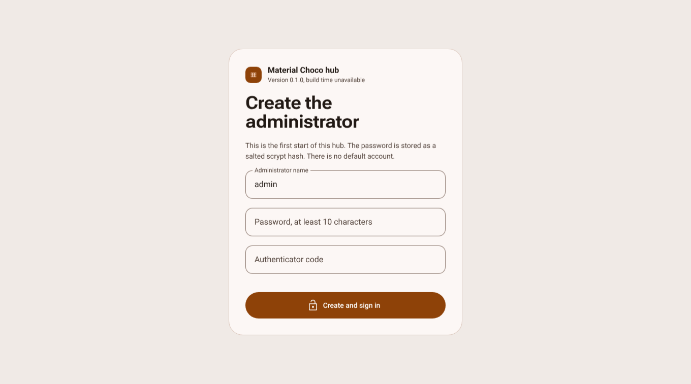

# Running the hub in a container

The hub is a small web app that lets you manage many Windows machines from a browser, including a phone. It runs in one container and has no runtime dependencies beyond Node.js.

> **Read the [security model](security-model.md) first.** The hub can install software with administrator rights on every machine paired with it. Hub access is administrator access.

## Start it

With Docker Compose, from the `material-choco` folder of the repository:

```
docker compose up -d
```

Or directly:

```
docker run -d -p 8080:8080 -v material-choco-data:/data ghcr.io/ding-ding-projects/material-choco-hub:latest
```

Then open `http://<host>:8080` from any device on the same network.

The image is based on `node:22-alpine`, runs as the non-root user `node`, keeps its data in the `/data` volume, and has a health check that calls `/api/status`.

## Create the administrator

The first visit shows **Create the administrator**. There is no default account.

- The name is 2 to 40 letters, digits, dot, dash, underscore or `@`.
- The password needs at least 10 characters. It is stored as a salted scrypt hash.

After that, setup is closed: the form cannot be used again. This first account is an admin, and can add more people under **Users and roles** as admin, operator or viewer.



A first-run wizard follows. On a hub its second step offers to create the first pairing code. See [Pairing and remote agents](pairing-and-remote-agents.md).

## Turn on HTTPS

Agents refuse plain HTTP to a remote hub unless they are started with an explicit opt-in, and a session cookie over plain HTTP can be read on the network. Use one of these:

**A certificate in the container.** Mount the files and set two variables:

```
docker run -d -p 8443:8080 \
  -v material-choco-data:/data -v /path/to/certs:/certs:ro \
  -e MATERIAL_CHOCO_TLS_CERT=/certs/cert.pem \
  -e MATERIAL_CHOCO_TLS_KEY=/certs/key.pem \
  ghcr.io/ding-ding-projects/material-choco-hub:latest
```

**A reverse proxy.** Terminate TLS in the proxy and forward to port 8080. The hub marks its session cookie `Secure` when the proxy sends `X-Forwarded-Proto: https`. The proxy must not buffer responses on `/api/events` or cut long requests on `/agent/poll`, which are held open for up to 25 seconds.

## Settings

| Variable | Default in the image | Meaning |
| --- | --- | --- |
| `MATERIAL_CHOCO_DATA` | `/data` | Folder for the store, job logs and history |
| `MATERIAL_CHOCO_PORT` | `8080` | Port to listen on |
| `MATERIAL_CHOCO_HOST` | `0.0.0.0` | Address to listen on |
| `MATERIAL_CHOCO_TLS_CERT` | not set | Path to a certificate file |
| `MATERIAL_CHOCO_TLS_KEY` | not set | Path to the private key file |
| `MATERIAL_CHOCO_ORIGIN` | not set | Public address of the hub, for passkeys behind a proxy that changes the `Host` header |
| `MATERIAL_CHOCO_KEY_FILE` | `secret.key` in the data folder | Where the key for secrets at rest is kept |

## Add a passkey

Open **Settings**, then **Sign in and locks**. From there you can change the password and add a [passkey](../features/passkeys.md), so that you sign in with a fingerprint, a face, a device PIN or a security key. The hub has no authenticator code step: sign in is a password or a passkey.

## Back up and update

Everything the hub knows is in the data volume, including the key file for secrets at rest: the users, paired machines with the hashes of their tokens, jobs, schedules, job logs and the history. Back up that volume. To update, pull the new image and recreate the container with the same volume.

## What was checked

The handoff note records that the image was built with `docker build`, run as a container, reached on the LAN address, passed its health check, ran as the non-root user, and that a real agent enrolled against it and reported inventory. The release workflow pushed the image to the registry. HTTPS through the two variables is covered by the code path but was not exercised in a recorded check.

## Known limits

- Passkeys exist and were tested with a software passkey device only, not with a real device in a real browser.
- Three fixed roles. A user cannot be limited to some machines, and every role can read job output and the history.
- Secret option values and webhook addresses are encrypted in the data file, but the key lies in the same data folder unless you move it with `MATERIAL_CHOCO_KEY_FILE`. Anyone who reads the whole folder reads the key too.
- Running the hub without a container (`npm run hub`) works for development and is not a supported deployment.

## Related

- [Pairing and remote agents](pairing-and-remote-agents.md): the next step
- [Security model](security-model.md): read before exposing a hub
- [Users and roles](../features/users-and-roles.md): give other people access
- [Status webhooks](../features/status-webhooks.md): hear about failed jobs
- [Jobs, schedules and history](jobs-schedules-and-history.md): what the hub does with commands
- [Hub HTTP API](../features/hub-http-api.md): routes and the Postman collection
