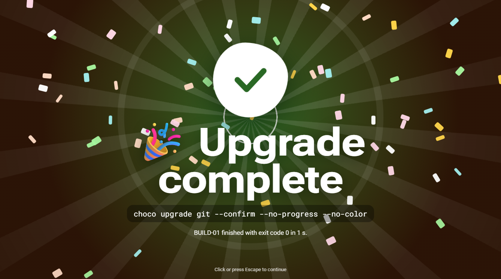
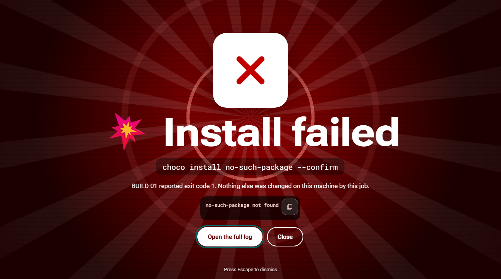

# Install result takeovers

When an install or an upgrade finishes, the result takes over the whole screen: a celebration when it worked, an alarm with the exit code and the last output when it did not. You cannot miss a failed install.

## When they appear

A takeover appears when a job ends and all of these are true:

- The command was `choco install` or `choco upgrade`.
- It was a real run, not a dry run with `--what-if`.
- It ended as succeeded or failed. Cancelled and expired jobs use a normal notification.
- The setting **Full-screen install results** is on, and **Low stimulation** is off.

It does not matter where the job was started. An upgrade started from another browser, by a schedule, or through the API also takes over every open window that is signed in to that hub, because the result arrives over the live event stream.

## Success

The screen shows **Install complete** or **Upgrade complete**, the command, the machine name, exit code 0 and how long the job took. It closes by itself after about five seconds, or at once with a click, `Escape`, `Enter` or `Space`.

If more installs finish while it is showing, the same screen counts them ("3 installs finished") and names the latest, so a fleet-wide upgrade does not stack dozens of overlays.

## Failure

The screen shows **Install failed** or **Upgrade failed**, the command, the machine, the exit code, and the last eight lines of output. It stays until you dismiss it: there is no timer. **Open the full log** jumps to the job; **Close** and `Escape` dismiss it. Several failures are shown one after another, so none is lost behind another.

While a failure is showing, focus stays inside it: `Tab` moves between the output and the two buttons.

## Turn them off

Open **Settings**, then **Appearance**, and switch off **Full-screen install results**. Results then arrive as ordinary notifications. The focus mode **Low stimulation** has the same effect and also turns off movement and sound.

## Motion and sound

With reduced motion, either from the operating system or from **Settings**, **Appearance**, **Motion**, the confetti and the flying shards are not created and the screen closes without an exit animation. The text, the exit code and the buttons are the same. A short sound plays unless action sounds are off.

## What was checked

End to end checks in `test/e2e/run.mjs`: `upgrade success takes over the screen`, `success takeover closes with Escape`, `install failure takes over with exit code and output`, `failure takeover stays until dismissed`, and `an install started elsewhere also gets the takeover`.

## Known limits

- The reduced motion path was written by rule and has not been captured or reviewed on screen.
- Takeovers cover install and upgrade only. Uninstall results use the job page and notifications.
- The install in these checks was performed by the test stand-in for `choco.exe`.

## Related

- [Jobs, schedules and history](jobs-schedules-and-history.md): the full log behind a result
- [Languages and accessibility](languages-and-accessibility.md): motion and sound settings
- [Confirming destructive actions](confirming-destructive-actions.md): care before an action, where this is care after it
- [Install result takeovers](../features/install-result-takeovers.md): the feature page
