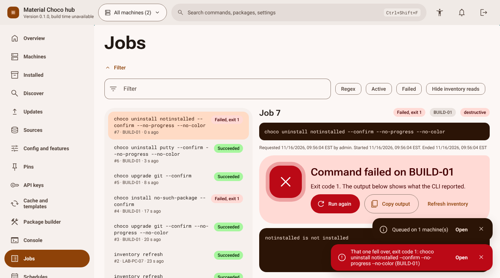
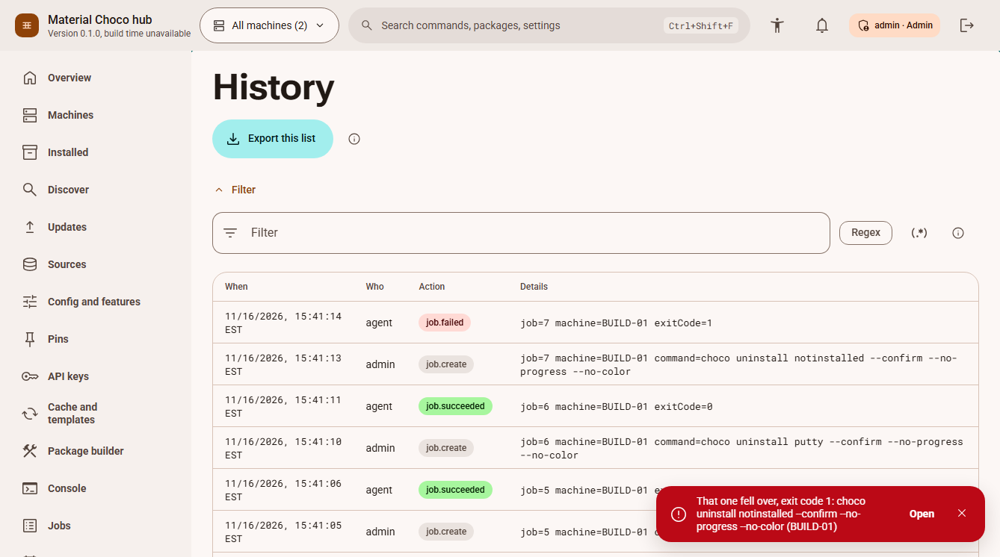

# Jobs, schedules and history

Everything you run becomes a job on one machine. This guide follows a job from the Run button to the history, and shows how to put jobs on a timetable.

## Choose where a command runs

The button at the top that reads **All machines** sets the machines that pages show and act on. Choose one machine, several, or all. Dialogs and the Console also have their own **Run on** list for a single command.

Running a command on three machines creates three jobs, one per machine.

## The life of a job

| State | Meaning |
| --- | --- |
| Queued | Waiting for the machine's agent. For an offline machine it waits up to 7 days |
| Running | The agent took it. Output arrives live |
| Succeeded | The CLI ended with exit code 0 |
| Failed | Any other exit code, a refusal by the agent, or a timeout |
| Cancelled | You cancelled it while queued or running |
| Expired | The machine did not come online within 7 days |

An agent runs one job at a time, in the order they were queued. A job is stopped after 240 minutes.

## The Jobs page

Select a job on the left to see its command, who requested it and when, its state, and the output. While a job runs, the output scrolls live and **Cancel** stops it. When it ends you get a success panel with the exit code or a failure panel with **Run again**, **Copy output** and **Refresh inventory**. **Export log** saves the output as a text file.

Filters narrow the list to active jobs, failed jobs, or hide the inventory reads that agents do after each change.

If the hub restarts while a job is running, the job is marked failed with a note that its result is unknown, because the hub can no longer vouch for it.

## Schedules

Open **Schedules** and choose **New schedule**.

- **What to run:** upgrade all packages, refresh the inventory, or a command you built in the Console and sent here with its **Schedule** button.
- **Where:** all machines including ones paired later, the machines currently selected, or a group.
- **When:** a time of day in the hub's time zone, and optionally the days of the week. No day selected means every day.

Schedules run on the hub, once per day at most. An offline machine receives its job when it returns, within 7 days. A read only machine is skipped when the command would change it. Each schedule has a switch to pause it.

## History

**History** is an append-only record kept by the hub: sign ins and failed sign ins, pairing codes, machines joining and leaving, every job created and how it ended, schedule runs, and account changes. Filter it, or export it as CSV, JSON or Markdown; the export follows the filter.

Source passwords and API keys are masked before a command is recorded.

## Notifications

A notification appears when a job is queued and when one of your jobs ends, with an **Open** button that jumps to the job. The bell in the top bar lists the notifications since the page was opened. Installs and upgrades also trigger a [full-screen result](install-result-takeovers.md).

## What was checked

- Tests in `test/hub.test.js`: `a job runs on the agent, streams output and refreshes inventory`, `a failing command reports its exit code`, `schedules create jobs at their time, once per day`, `history is recorded and secrets stay out of it`.
- End to end checks: `inventory refreshes after a change`, `job page shows the success state with exit code`, `failed job shows exit code and output`, `history records actions`.

## Known limits

- The hub keeps the newest 2,000 jobs.
- The job list does not keep the original options of a job, so **Run again** opens the Console on that command for you to fill in.
- Schedules are daily or weekly at one time of day. There are no intervals or cron expressions.
- A bulk action is one job per row or machine, not one transaction.

## Related

- [Every command and option](commands-and-options.md): build the command first
- [Install result takeovers](install-result-takeovers.md): the full-screen results
- [Pairing and remote agents](pairing-and-remote-agents.md): where jobs run
- [Offline job queue](../features/offline-job-queue.md): the 7 day wait in detail
