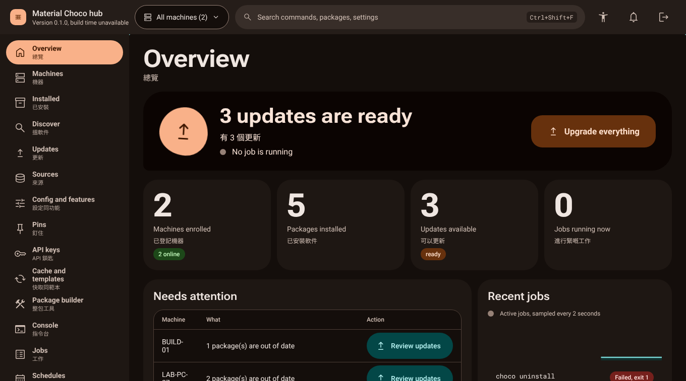

# Languages and accessibility

The interface comes in three language modes and has a set of comfort tools that are always one click away. This guide covers what each does and, just as important, how far each goes today.

## Language modes

Open **Settings**, then **Language**, or choose a mode in the first-run wizard.

| Mode | What you see |
| --- | --- |
| English | English only |
| Hong Kong Cantonese | Cantonese where a translation exists, English elsewhere |
| Bilingual | English first, with a compact Cantonese line beneath |

Navigation, headings, actions, messages and the sentences of the newer pages have Cantonese entries. A sentence without an entry stays English, so some page text can still appear in English in every mode.



## Tone

Each language has its own **funny level** from 1 (fully serious) to 5 (most playful). Both ship at 5. At levels 4 and 5, messages that have a playful variant use it. The facts in a message never change with the level: the exit code and the command are the same at every setting. A separate switch adds or removes the decorative emoji in dialog titles.

## Your own wording

You can load a personal wording file that replaces words in translated text.

```
{
  "schemaVersion": 1,
  "name": "My wording",
  "entries": { "Machines": "Computers", "Upgrade": "Update" }
}
```

Drop the JSON file anywhere on the window, or choose it under **Settings**, **Language**, **Personal wording**. The whole file is checked before anything changes: at most 256 KiB, nested at most 8 levels, keys of at most 160 characters, text values of at most 1,000 characters. A file that fails any rule is refused whole. The file stays in this browser and is never sent to the hub. **Replace file** and **Clear** are on the same page.

## A plain mode for shared screens

**School mode** forces English, hides the playful options and ignores a personal wording file. You can rename the mode and set a PIN that is asked for when turning it off. It is a convenience lock and not security: clearing the site's storage resets it.

## Accessibility tools

The person icon in the top bar, or `Ctrl+Shift+A`, opens a menu that cycles each setting in place. The same settings are under **Settings**, **Accessibility tools**.

| Setting | Choices |
| --- | --- |
| Text size | Small, Normal, Large, Larger, Largest. Scales text and spacing together |
| Contrast | Normal, High. High darkens secondary text and outlines |
| Motion | System, Reduced, Full. Reduced replaces movement with instant changes |
| Touch targets | Normal, Large. Large raises controls to 56 px |
| Focus ring | Normal, Bold |
| Theme | System, Light, Dark |

Under **Appearance** you can also pick **Compact** density and change the seed colour that every colour in the app derives from. Theme, density, motion, contrast and sounds can also [switch by the clock](../features/timed-settings.md), for example a dark theme in the evening.

## Sound and speech

**Action sounds** are short cues when a job is queued, finishes or fails. Everything they signal is also visible. A **spoken narrator**, off by default, reads job results aloud using the voices installed on your device, with pickers for an English and a Cantonese voice, rate and pitch.

## Focus modes

Five separate switches under **Settings**, **Focus modes**, all off by default:

- **Focus** collapses the tab strip to icons and hides the Overview banner.
- **Low stimulation** turns off movement, mutes colour and silences sounds.
- **Time awareness** shows a clock in the top bar and elapsed time on running jobs.
- **One thing at a time** shows one machine per page.
- **Momentum** offers the next logical step when a job finishes.

## Keyboard

| Keys | Action |
| --- | --- |
| `Ctrl+Shift+F` | Open the command palette |
| `Ctrl+Shift+U` | Go to Updates |
| `Ctrl+Shift+J` | Go to Jobs |
| `Ctrl+Shift+A` | Open the accessibility tools |
| `F1` | Open Help |
| `/` | Focus the filter of the current page |
| `Shift+F10` | Open the menu of the focused element |
| `Escape` | Close the open dialog or menu |

The full list is on the [keyboard shortcuts](../features/keyboard-shortcuts.md) page.

Dialogs keep focus inside them and return it to where you were when they close.

## What was checked

End to end checks: `bilingual mode shows the Cantonese line`, `Cantonese mode translates a new page`, `playful wording changes the voice and keeps the facts`, `dark theme applies`, `invalid personal wording file is refused whole`, `Ctrl+Shift+F opens the palette and filters`, and `phone layout has no horizontal overflow`.

## Known limits

Said plainly, because this is the area with the most left to do:

- No formal accessibility audit has been done, and no screen reader pass.
- Reduced motion was written by rule and not captured or reviewed on screen.
- Display scaling and the larger text sizes have not been checked page by page for clipping.
- Not every sentence has a Cantonese entry yet.
- Settings are stored per browser and are not shared between devices.

## Related

- [Finding your way around](finding-your-way-around.md): palette, tabs and menus
- [Install result takeovers](install-result-takeovers.md): how motion settings change them
- [Accessibility tools](../features/accessibility-tools.md): the feature page
- [Language modes](../features/language-modes.md): the feature page
