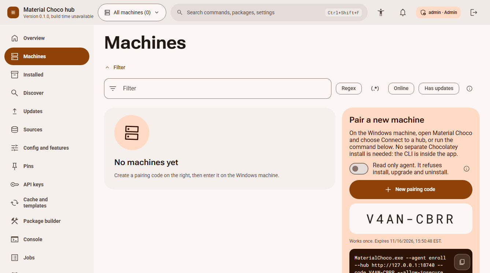
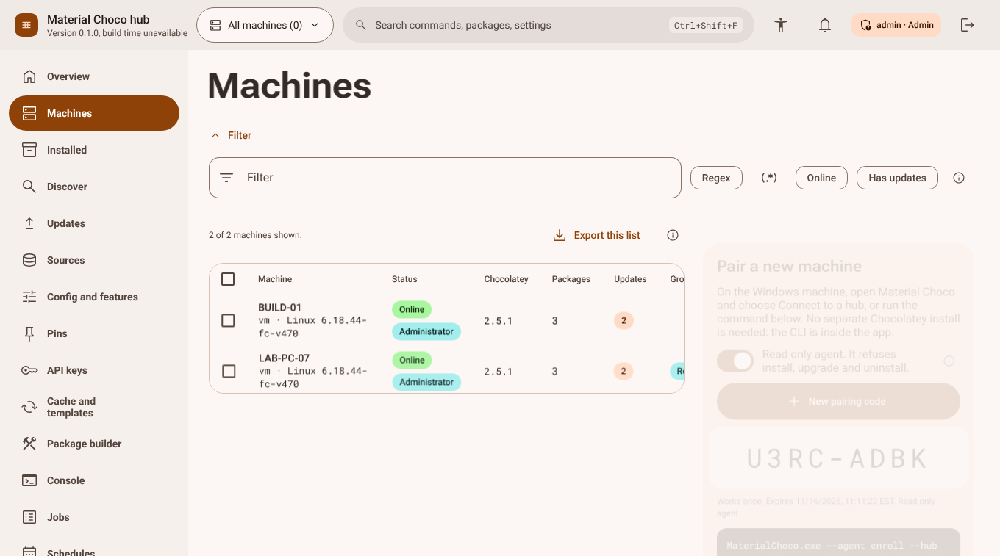

# Pairing and remote agents

A Windows machine joins a hub by entering a one time pairing code. After that it connects out to the hub as an agent, so the hub never needs to reach into the machine's network.

## Create a pairing code

1. Sign in to the hub and open **Machines**.
2. In **Pair a new machine**, decide whether the agent should be read only (see below), then choose **New pairing code**.
3. The hub shows a code like `XXXX-XXXX`, its expiry time, and the exact command for the machine.

A code works once and expires after 10 minutes. The hub stores only a hash of it. A fold under the code draws a QR code holding the hub address and the code, for reading with another device; the desktop app does not scan it yet.



## Enter it in the desktop app

On the Windows machine, open Material Choco, go to **Machines**, and use **Connect this PC to a hub**: enter the hub address and the code. The app keeps managing the PC locally and also serves the hub.

## Or enroll a server without a desktop session

```
MaterialChoco.exe --agent enroll --hub https://hub.example:8443 --code XXXX-XXXX
MaterialChoco.exe --agent run
```

| Command | What it does |
| --- | --- |
| `--agent enroll --hub URL --code CODE` | Pairs this machine. Optional: `--name NAME`, `--read-only`, `--allow-insecure` |
| `--agent run` | Connects and waits for jobs. Prints each state change |
| `--agent status` | Prints the hub address, machine id, state and last error as JSON |
| `--agent disconnect` | Deletes the local pairing. The hub still lists the machine until you remove it there |

The headless agent keeps its pairing in `agent.json` under `%ProgramData%\MaterialChoco` (or the folder named by `MATERIAL_CHOCO_DATA`). `--agent run` stays in the foreground. Starting it at boot, for example with Task Scheduler, is up to you: the app does not install a Windows service.

## HTTPS and the opt-in for plain HTTP

The agent refuses `http://` addresses unless the hub is on the same computer. For a trusted LAN without TLS you can opt in with `--allow-insecure`, or the matching switch in the app. Anyone on that network can then read the traffic, including the agent's token, so prefer HTTPS.

## Read only agents

A read only agent refuses every command that changes the machine: install, upgrade, uninstall, push, and the changing subcommands of pin, source, config, feature, apikey and cache. Inventory, search, list and info still work, and so does a dry run.

When a machine is paired as read only, with the switch on the pairing code or with `--read-only` on the machine, the refusal is enforced twice: the hub refuses to queue such a job, and the agent itself refuses it again if one arrives anyway. You can also turn read only on later from the machine's menu under **Rename, groups, policy**; that later switch is enforced by the hub only.

## Limit a machine to some commands

Read only is all or nothing. For a finer limit, an admin can tick the commands the hub accepts for a machine under **Rename, groups, policy**, **Allowed commands**. The machine can also carry its own list, which the hub cannot change:

```
MaterialChoco.exe --agent enroll --hub https://hub.example:8443 --code XXXX-XXXX --allow list,outdated,upgrade
```

A job outside either list is not created, and the agent refuses it by itself if one arrives. See [command allow lists](../features/command-allow-lists.md).

## What the agent does once paired

- It long-polls the hub for jobs. A machine counts as online when it was seen in the last 75 seconds.
- It runs one job at a time through the bundled Chocolatey CLI and streams the output back while the job runs.
- After a command that changes the machine it re-reads the inventory: packages, outdated packages, sources, config, features and pins.
- If the hub cannot be reached it retries with a growing delay, up to 30 seconds between attempts.
- If the hub answers that the token is no longer accepted, the agent stops and reports that it must be enrolled again.

Jobs for an offline machine wait in the hub for up to 7 days, then expire.



## Names, groups and removal

Open a machine's menu (the three dots, right click, or `Shift+F10`) for **Open packages**, **Refresh inventory**, **Rename, groups, policy** and **Remove from hub**. Groups are free text labels that schedules can target.

**Remove from hub** asks for the two key confirmation. The hub then forgets the machine, its inventory and its token, and cancels its queued jobs. Nothing is uninstalled on the machine itself. The agent's token stops working at once.

## What was checked

- Test `agent enrolls with a one time code and reports inventory from the bundled CLI` and test `removing a machine revokes its agent` in `test/hub.test.js`.
- Test `read only machines refuse changes in the hub and in the agent`.
- End to end checks `a pairing code works only once`, `two agents enrolled and reported inventory through the bundled CLI`, `read only machine refuses a change` and `unknown agent token is refused` in `test/e2e/run.mjs`.

In all of these the CLI was the test stand-in, and the agents ran on Linux.

## Known limits

- No agent has yet run on Windows against the real `choco.exe`.
- No Windows service is installed for the headless agent.
- Agent updates are not signed.

## Related

- [Running the hub in a container](hub-in-a-container.md): start the hub first
- [Security model](security-model.md): what a paired machine trusts
- [Jobs, schedules and history](jobs-schedules-and-history.md): running commands on many machines
- [Read only agents](../features/read-only-agents.md): the feature page
